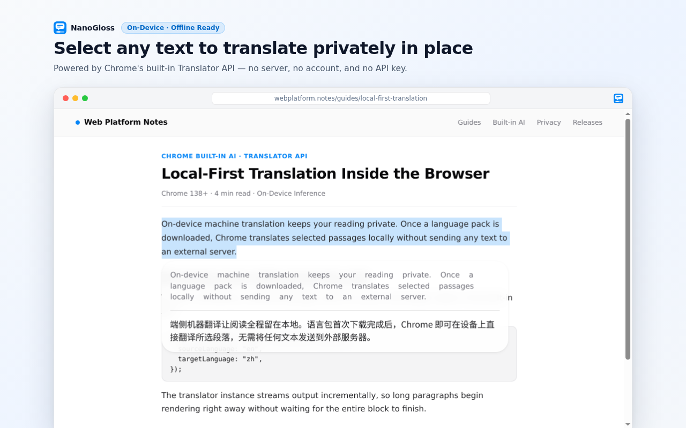

# NanoGloss

[English](README.md) · [简体中文](README.zh-CN.md) · [Available on the Chrome Web Store](https://chromewebstore.google.com/detail/nanogloss/caecnjjpamjmaiejpmnakeheodhbbhon)

Fast, on-device selection translation powered by **Chrome's built-in translation model** — your selected text stays on your machine, works offline after Chrome downloads a language pack once, and needs no server, account, or API key.



## Chrome's built-in model and measured speed

Language detection and translation run inside Chrome on your machine, avoiding cloud network round trips and server queues:

- **Fast local response**: short sentences finish in `208–228 ms` from releasing the mouse to rendered translation for direct English pairs (`en ↔ zh`, `en → ja`; `317 ms` when pivoting `ja → zh`), and 25–55-word paragraphs finish in `274–503 ms` depending on whether the isolated bubble UI is already initialized and whether background work (such as screen recording) is sharing CPU.
- **Streaming on long passages**: raw model inference starts streaming in `25–62 ms` (`221–235 ms` to first rendered text in the bubble, including creating a fresh `Translator` instance), finishing a 3-paragraph (~1,400-char) passage in `0.82–1.01 s`.
- **Instant repeat selections**: re-selecting a recent passage in the same tab hits the in-memory cache in `5.8 ms` median.
- **Compact expert model, offline after one download**: Chrome's [Translator API](https://developer.chrome.com/docs/ai/translator-api) and [Language Detector API](https://developer.chrome.com/docs/ai/language-detection) use task-specific **expert models** (`TranslateKit` bidirectional NMT weights, ~`76 MiB` per language pack) rather than Chrome's larger generative foundation model, so they do not require the 22 GB free-disk or >4 GB VRAM thresholds of foundation-model APIs. Chrome downloads each language pack once from Google on first use (~`3.2 s` on broadband), after which translation works completely offline.

Measured with `performance.now()` on a MacBook Pro (`MacBookPro15,1`, Intel Core i9-9880H, 16 GB RAM, Chrome 157) using distinct inputs per run; speed varies with hardware and language pair. Full benchmarks, API breakdown, and on-disk model layout are in [docs/on-device-translation.md](docs/on-device-translation.md).

## Features

- **Interactive welcome tour**: opens a practice page on first install to verify browser support, prepare your language pack, and try each selection gesture while timing Chrome's local model live.
- **Isolated selection bubble**: renders source and translated text inside a Shadow DOM card that resists host-page CSS; keeps block-level code (`<pre>`) verbatim while translating prose.
- **Non-intrusive trigger gestures**: hold `Alt` (`Option` on macOS) while selecting or long-press the mouse button at the end of a selection so everyday copying is undisturbed, or switch to automatic translation on every selection.
- **On-device language pack management**: supports automatic source-language detection, live download progress inside the bubble, and a ready-pack overview in Settings.
- **Built-in playground & diagnostics**: test translations and inspect browser capability checks directly on the Settings page.
- **Themes & localized UI**: follows system, light, or dark appearance and localizes the interface in English, Simplified Chinese, Traditional Chinese, and Japanese.

Desktop Google Chrome 138 or newer is required; mobile browsers, Firefox, and Safari do not ship Chrome's built-in Translator API.

## Install

### Option 1: Chrome Web Store (recommended)

Install directly from the [Chrome Web Store](https://chromewebstore.google.com/detail/nanogloss/caecnjjpamjmaiejpmnakeheodhbbhon).

### Option 2: From GitHub Releases (no build tools required)

1. Download the latest `nanogloss-<version>-chrome.zip` from [Releases](https://github.com/shaonianche/nanogloss/releases) and unzip it to a folder.
2. Open `chrome://extensions` in desktop Chrome and enable **Developer mode**.
3. Click **Load unpacked** and select the unzipped folder.

### Option 3: Build from source

Requires Node.js 26 and pnpm 12 (see `package.json`).

```bash
git clone https://github.com/shaonianche/nanogloss.git
cd nanogloss
pnpm install
pnpm build
```

Open `chrome://extensions`, enable **Developer mode**, click **Load unpacked**, and choose `.output/chrome-mv3`.

Installing opens the guided welcome page once. Click the toolbar icon at any time to open Settings, or use **Welcome tour** in the Settings header to revisit the practice page.

## Use

Hold `Alt` (`Option` on macOS) while selecting text, or hold the left mouse button for about a second at the end of a selection. Press `Esc` or click outside the bubble to close it. You can change languages or switch to translating every selection in Settings.

The first translation for a new language downloads a ~76 MB language pack through Chrome; if the gesture lacked browser user activation, click **Download language pack** in the bubble to start it.

## Known limitations

- Chrome blocks extensions on internal `chrome://` pages and the Chrome Web Store, so selections there cannot be translated.
- Chrome exposes the Translator API only to top-level documents and same-origin iframes by default; cross-origin iframes require `allow="translator"` from the embedding page.
- Selections inside form fields and editable elements are ignored.
- Only block-level code (`<pre>` and code-only blocks) is kept verbatim. Inline `<code>` inside a sentence is sent with the sentence so the translator receives complete grammar, which means identifiers or strings inside inline code may change.
- To prevent site fingerprinting, Chrome tracks language-pack readiness per origin: a pack downloaded on a web page is already on disk, but may not appear under **Ready language packs** on the Settings page until Settings uses that language too.
- A first language-pack download occasionally fails in Chrome; clicking **Try again** in the bubble or Settings usually succeeds.
- `chrome://on-device-translation-internals/`, linked from System Status, renders blank in some Chrome releases.
- Non-English language pairs translate on-device via English as a pivot and require both languages' packs.

## Privacy

NanoGloss has no server, no analytics, and no ads, and makes no network requests of its own. Selected text stays in tab memory only for Chrome's local model and is cleared when the tab closes or reloads; settings live in `chrome.storage.local`. Network access occurs only when Chrome itself downloads or updates on-device model components and language packs from Google. See [PRIVACY.md](PRIVACY.md).

## Documentation & Contributing

- [On-device AI model & measured translation speed](docs/on-device-translation.md) ([简体中文](docs/on-device-translation.zh-CN.md))
- [Architecture, Shadow DOM styling & build scripts](docs/architecture.md) ([简体中文](docs/architecture.zh-CN.md))
- [Contributing guide](CONTRIBUTING.md), [Code of Conduct](CODE_OF_CONDUCT.md), [Security policy](SECURITY.md), and [Changelog](CHANGELOG.md)

## License

The source code is licensed under the [MIT License](LICENSE). Third-party notices are summarized in [THIRD_PARTY_NOTICES.md](THIRD_PARTY_NOTICES.md), with full license texts packaged in `THIRD_PARTY_NOTICES.txt`.

The NanoGloss name, logo, extension icons, Chrome Web Store screenshots and promotional images, and store listing copy are brand assets and are not covered by the MIT License; see [BRAND.md](BRAND.md).
