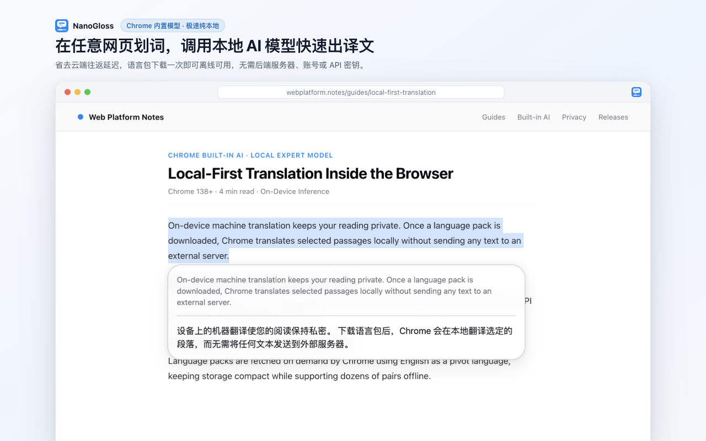

# NanoGloss

[English](README.md) · [简体中文](README.zh-CN.md)

基于 **Chrome 内置本地翻译模型**的极速划词翻译扩展——选中文本全程不出本机，由 Chrome 下载一次语言包后即可断网离线使用，无需后端服务器、注册账号或配置 API 密钥。



## Chrome 内置模型与实测速度

语种检测与翻译推理全部在本地 Chrome 进程内完成，省去了云端接口的网络往返与排队等待：

- **本地快速响应**：在已加载的页面中，日常短句从松开鼠标到译文渲染完成实测为 `208–228 ms`（`en ↔ zh`、`en → ja`；经英语中转的 `ja → zh` 为 `317 ms`），25–55 词段落完成耗时 `274–377 ms`（新开页面首次触发因需初始化隔离气泡样式，总耗时约 `0.5 秒`）。
- **长文流式上屏**：底层模型纯推理 `25–62 ms` 即吐出首块译文（算上新建 `Translator` 实例与渲染，气泡首字上屏为 `221–235 ms`），约 1,400 字符的三段长文在 `0.82–1.01 秒` 内译完。
- **重复划选瞬时命中**：当前标签页内重复划选近期译过的文本直接命中内存缓存，中位数仅 `5.8 ms`。
- **轻量专用模型，一次下载后离线可用**：Chrome 的 [Translator API](https://developer.chrome.com/docs/ai/translator-api) 与 [Language Detector API](https://developer.chrome.com/docs/ai/language-detection) 采用专为翻译训练的轻量**专家模型**（`TranslateKit` 双向 NMT 模型，单个语言包约 `76 MiB`），而非通用基础大模型，因此没有基础大模型所需的 22 GB 可用磁盘空间与 4 GB 显存门槛。首次使用某语种时由 Chrome 从 Google 下载一次语言包（宽带下约 `3.2 秒`），此后完全离线可用。

以上数据在 MacBook Pro（`MacBookPro15,1`，Intel Core i9-9880H，16 GB 内存，Chrome 157）上通过 `performance.now()` 逐次使用不同原文实测；实际速度因设备硬件与语言组合而异。完整分语种数据、底层 API 耗时拆解与磁盘模型结构见 [docs/on-device-translation.zh-CN.md](docs/on-device-translation.zh-CN.md)。

## 功能特性

- **交互式欢迎导览**：首次安装自动打开练习页，引导检查浏览器环境、准备语言包并体验三种触发手势，实时显示本地模型完成每次翻译的毫秒耗时。
- **样式隔离的划词气泡**：基于 Shadow DOM 渲染原文与译文，不受宿主网页样式干扰；自动保留块级代码（`<pre>`）原样，只翻译说明正文。
- **防误触快捷手势**：默认按住 `Alt`（macOS 为 `Option`）划词或划词结束长按鼠标左键触发，不打断日常复制选字；也可在设置中切换为「划词后立即翻译」。
- **本机语言包管理**：支持源语言自动检测，在气泡内实时查看首次下载进度，并在设置页查看已就绪的语言包。
- **内置翻译测试台与诊断**：在设置页直接输入或点选示例文本验证本地翻译效果，一键检查浏览器支持状态。
- **主题与多语言界面**：自动跟随系统浅色 / 深色外观，界面支持简体中文、繁体中文、英语与日语。

需要桌面端 Google Chrome 138 或更高版本；移动端浏览器以及 Firefox、Safari 未提供该内置翻译模型。

## 安装

### 方式一：从 GitHub Releases 下载加载（无需本地编译环境）

1. 前往 [Releases](https://github.com/shaonianche/nanogloss/releases) 下载最新的 `nanogloss-<version>-chrome.zip` 并解压到本地文件夹。
2. 在桌面端 Chrome 打开 `chrome://extensions`，开启右上角「开发者模式」。
3. 点击「加载已解压的扩展程序」，选择解压后的文件夹。

### 方式二：从源码构建

需要 Node.js 26 与 pnpm 12（版本定义见 `package.json`）。

```bash
git clone https://github.com/shaonianche/nanogloss.git
cd nanogloss
pnpm install
pnpm build
```

打开 `chrome://extensions` 开启「开发者模式」，点击「加载已解压的扩展程序」并选择 `.output/chrome-mv3`。

安装完成后会自动打开欢迎页导览；日常点击浏览器工具栏图标即可打开设置页，点击设置页顶部的「使用导览」可随时重开欢迎页。

## 使用说明

按住 `Alt` 键（macOS 为 `Option` 键）拖动划词，或在划词结束时按住鼠标左键约 1 秒不放，译文即会流式呈现在选区旁的气泡中；按 `Esc` 或点击页面空白处关闭气泡。可在设置页修改源语言、目标语言，或切换为每次划词自动翻译。

首次使用某个新语种时，Chrome 会下载一次约 76 MB 的本地语言包；若当前手势缺少浏览器激活状态，点击一下气泡中的「下载语言包」按钮即可开始。

## 已知限制

- Chrome 禁止扩展在浏览器内部页面（`chrome://…`）和 Chrome 应用商店页面运行，这些页面内无法划词翻译。
- Chrome 默认仅向顶层页面和同源 `iframe` 暴露 Translator API；跨域 `iframe` 需由外层页面声明 `allow="translator"` 才能使用。
- 输入框与可编辑区域内的选区会被自动忽略。
- 仅块级代码（`<pre>` 及纯代码段落）原样保留；句子中间的行内 `<code>` 会随整句一并送入翻译模型以保持语序完整，其中的标识符或字符串可能被改动。
- 为防止站点指纹追踪，Chrome 按网站隔离报告语言包就绪状态；在普通网页上首次触发下载的语言包已保存在本机磁盘，但可能要等设置页也调用过该语种后才会显示在设置页的「已就绪」列表里。
- 语言包首次下载偶有中断，点击气泡或设置页中的「重试」通常即可完成。
- 「系统状态」页关联的 `chrome://on-device-translation-internals/` 在部分 Chrome 版本中显示为空白页。
- 非英语语种之间互译由 Chrome 在本机经英语中转完成，需同时具备两个语种的语言包。

## 隐私保护

NanoGloss 没有后端服务器，不含统计追踪与广告，扩展自身不发起任何网络请求。划词文本仅在页面内存中交给 Chrome 内置本地模型处理，关闭或刷新标签页即清空；扩展设置保存在本机 `chrome.storage.local`。仅在首次下载或更新本地模型组件与语言包时，由 Chrome 浏览器自身连接 Google 完成下载。详见 [PRIVACY.md](PRIVACY.md)。

## 延伸文档与参与贡献

- [本地 AI 模型原理与实测速度报告](docs/on-device-translation.zh-CN.md)（[English](docs/on-device-translation.md)）
- [技术架构、Shadow DOM 样式隔离与构建脚本](docs/architecture.zh-CN.md)（[English](docs/architecture.md)）
- [贡献指南](CONTRIBUTING.md)、[行为准则](CODE_OF_CONDUCT.md)、[安全策略](SECURITY.md) 与 [更新日志](CHANGELOG.md)

## 许可证

源代码以 [MIT 许可证](LICENSE) 开源。第三方开源组件声明见 [THIRD_PARTY_NOTICES.md](THIRD_PARTY_NOTICES.md)，完整许可证文本随扩展打包在 `THIRD_PARTY_NOTICES.txt` 中。

NanoGloss 名称、Logo、扩展图标、Chrome 应用商店截图与宣传图以及商店上架文案属于品牌资源，不在 MIT 许可证授权范围内，详见 [BRAND.md](BRAND.md)。
